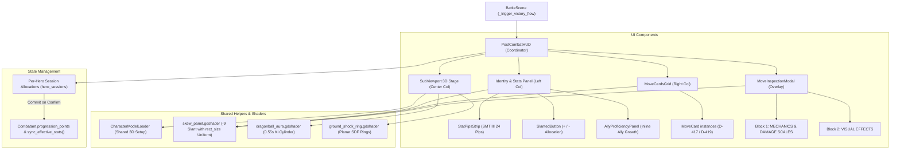

# Post-Combat Progression HUD & Universal Move Card Architecture in Godot 4.7

*   **Author:** Rafael
*   **Status:** Approved (EGM Verified — Ready for Implementation)
*   **Date:** 2026-11-08

--------------------------------------------------------------------------------

## Decisões Aplicáveis

*   **D-001 / D-002 / D-003**: Regras de combate congeladas; separação estrita de escopos e autoridade documental.
*   **D-135**: Progressão de atributos do Líder com alocação manual de pontos.
*   **D-235**: Independência universal de Moves (moves, fichas e VFX são 100% agnósticos de combatente, time ou lado do campo).
*   **D-269**: Sistema de posicionamento, distâncias e alcance.
*   **D-390**: Orçamento inicial estrito de 15 pontos base no nível 1.
*   **D-391**: Renomeação de SPI para WIS e fórmula de progressão e escala de MP.
*   **D-392**: Escala de HP anti-hitkill e marcos de atributos (milestones a cada 5 pontos).
*   **D-393**: Escopo de 8 Natures iniciais e modificadores estáticos de atributos.
*   **D-394**: Progressão de 1 ponto/nível manual no Líder; proficiências orgânicas e automáticas nos aliados.
*   **D-395 / D-396 / D-397 / D-398**: Ícones de tipo, alcance, elemento, setas de natureza com fundo branco e elementos Mystic/Almighty.
*   **D-399**: Curva de XP e recompensas pós-combate.
*   **D-400**: Tela de vitória e pausa pós-combate com exibição de espólios e ouro.
*   **D-401**: Trava obrigatória de saída ("RETURN TO DUNGEON") enquanto houver pontos de atributo pendentes no Líder.
*   **D-402**: Concessão de XP pós-combate estritamente para combatentes sobreviventes.
*   **D-413**: Regeneração de MP a cada 8s, custos de moves e textos da HUD 100% em inglês.
*   **D-414 / D-415**: Vórtice espiral de Wind oficial e ajustes de brilho/escala dos ícones.
*   **D-416 / D-417**: Paralelogramos flat com fundos temáticos de elemento e marcas d'água em baixo-relevo sem bordas chanfradas.
*   **D-418**: Efeito de celebração de nível: pilar de aura Ki Dragon Ball de 0.55s sem flashes de tela inteira (segurança fotossensível).
*   **D-419**: Layout das fichas de moves: trio de badges em linha (Tipo, Alcance, Elemento), chips de custo ATB/MP/DMG.
*   **D-420**: Modal de inspeção técnica de move em tela cheia com blackout, sem repetições, com 2 blocos consolidados ("MECHANICS & DAMAGE SCALES" e "VISUAL EFFECTS"), atalho Z / clique no card.
*   **D-421 / D-422**: Painel de status integrado com gauges, pips SMT III e tooltips de natureza.
*   **D-423**: Alinhamento óptico dos badges de elemento no roster.

--------------------------------------------------------------------------------

## Overview

This technical design document establishes the production architecture to implement the unified **SMT III Post-Combat Progression Screen** in Godot 4.7 with 1:1 visual and behavioral fidelity to the verified HTML prototype (`prototypes/hud_post_combat.html`).

The system unifies combat victory resolution, surviving-only XP calculation (D-399/D-402), Leader manual point allocation (D-135/D-390/D-394/D-401), universal flat move cards with low-relief embossed watermarks (D-416/D-417/D-419), non-epileptic 0.55s Dragon Ball aura boost celebration (D-418), and full-screen 2-block move inspection modal (D-420) into a decoupled, performant engine architecture.

## The Problem

Currently, post-combat feedback in `scripts/combat/battle_scene.gd` depends on legacy, disconnected immediate-mode text overlays (`scripts/ui/victory_panel.gd` and `scripts/ui/level_up_modal.gd`). These legacy overlays:
1. Lack visual integration with the 3D character models and SMT III Nocturne aesthetic.
2. Do not implement the mandatory Leader point allocation exit lock required by decision D-401.
3. Lack support for universal move cards with element flat backgrounds, watermarks, cost parallelograms, and full-screen technical inspection modals.
4. Risk concurrent merge conflicts if implemented directly inside active combat scripts (`status_screen.gd` or `battle_hud.gd`).

The proposed solution constructs a standalone, decoupled `PostCombatHUD` control (`res://scenes/ui/post_combat_hud.tscn`) and reusable `MoveCard` component (`res://scenes/ui/components/move_card.tscn`), tested independently in an isolated lab scene (`res://scenes/debug/post_combat_hud_lab.tscn`).

## Goals

*   **G1: 1:1 Visual & Layout Parity with HTML Prototype:** Replicate the 3-column SMT III layout, $-9^\circ$ slanted parallelogram containers, Teko uppercase headings, Chakra Petch formula blocks, Barlow Condensed body text, and SMT III 24-pip segmented stat bars.
*   **G2: Strict Game Rule Enforcement:** Hard-lock the "RETURN TO DUNGEON" button while the party Leader has unallocated stat points (D-401). Enforce organic, non-interactive proficiency growth for allies (D-394). Award XP only to surviving combatants (D-402).
*   **G3: Photosensitive Safety (D-418):** Implement the 0.55s Dragon Ball aura boost as a localized additive 3D cylinder mesh with expanding planar ground shock rings, strictly forbidding full-screen screen flashes.
*   **G4: Input & Ergonomics Completeness:** Support mouse clicks on the full card area, keyboard (`Z` inspection keybind, Tab / Q-E hero swap, arrows, ESC/Enter modal dismiss), and gamepad navigation (D-pad, `ui_inspect` / `X` button, `ui_cancel` / `B` button) with center-origin slanted button collision picking via `_has_point()` and non-deadlocking focus trapping.
*   **G5: Concurrent Session Safety:** Zero modifications to `scripts/ui/status_screen.gd` or `scripts/ui/battle_hud.gd`.

## Non-Goals

*   **NG1: Combat Balance Modifications:** Modifying base attribute curves, HP formulas, MP scaling formulas, or damage equations (frozen in D-390, D-391, and D-392).
*   **NG2: Immediate Refactor of In-Combat HUDs:** Replacing `battle_hud.gd` or `status_screen.gd` immediately; they will consume the standalone `MoveCard` component in future sessions.
*   **NG3: Inventory / Equipment Management:** Managing inventory items or equipment swaps during this screen (limited to displaying battle spoils and gold per D-400).

## Open Questions

*   **None**: All architectural constraints, shader mechanisms, focus trapping protocols, and EGM review findings (Stages 5–9) have been evaluated, resolved, and integrated into this specification.

## Critical User Journeys (CUJs)

### CUJ 1: Post-Combat Victory & Leader Stat Allocation (D-401)
*   **Given**: Player completes a combat encounter where the party Leader (Abra) gains a level and earns 1 distributable stat point (`distributable_points == 1`).
*   **When**: `battle_scene.gd:_trigger_victory_flow()` pauses the combat tree and invokes `PostCombatHUD.open(party_summaries, total_xp)`.
*   **Then**:
    1. Abra's 3D model mounts via `CharacterModelLoader` in an isolated `SubViewport` and performs the victory jump while the 0.55s D-418 Dragon Ball aura pillar and floor shock rings fire.
    2. The party tab shows `[LV UP!]` badge, and the "AVAILABLE: 1 PT" pill pulses in yellow.
    3. The stat allocation `+` buttons pulse with neon cyan aura glow (`#00d8f6`).
    4. "RETURN TO DUNGEON" button is disabled; attempting to activate it displays the flashing D-401 warning banner.
    5. Player increments MAG by 1 and clicks "CONFIRM ALLOCATIONS". Points are committed to `hero.progression_points["MAG"]`, `distributable_points` decrements, `sync_effective_stats()` and `update_resource_maximums()` execute, the lock is lifted, and "RETURN TO DUNGEON" becomes active.
    6. When "RETURN TO DUNGEON" is pressed, `PostCombatHUD` emits `completed`, the tree unpauses, time scale resets, and `GameState.end_battle(true)` resumes dungeon exploration.

### CUJ 2: Move Card Inspection Modal (D-420)
*   **Given**: Player is viewing Abra's move list in the Right Column of `PostCombatHUD`.
*   **When**: Player clicks anywhere on the `PSYBEAM` card, presses `Z` (or gamepad `X` button mapped to `ui_inspect`), or selects it and presses `Enter`/`Space`.
*   **Then**:
    1. A full-screen blackout backdrop (`Color(0,0,0,0.95)`) darkens the entire HUD and traps keyboard/mouse focus (`mouse_filter = STOP`).
    2. Focus is routed to the modal's `close_button` (`close_button.grab_focus()`), preventing gamepad/keyboard navigation deadlocks.
    3. The modal card opens with a $-9^\circ$ slant, displaying Block 1 (`MECHANICS & DAMAGE SCALES`) and Block 2 (`VISUAL EFFECTS`).
    4. The exact damage formula is dynamically calculated via local helper `_format_damage_formula(skill, caster)` and displayed on a single line in Chakra Petch monospace (`40 [Base] + (1.2 × 8 [MAG]) = 50 DMG`).
    5. Pressing `ESC`, `Enter`, gamepad `B`, or clicking the backdrop dismisses the modal and returns focus directly to the originating `PSYBEAM` card (`card.grab_focus()`).

### CUJ 3: Dynamic Multi-Party Navigation & Ally Organic Growth (D-394 & D-405)
*   **Given**: Active party has multiple combatants (e.g., Abra Leader, Pancham Ally, Gible Ally).
*   **When**: Player switches tabs via Tab or `Q`/`E`.
*   **Then**:
    1. Selected member's 3D model mounts in the center viewport via `CharacterModelLoader`.
    2. Any pending session points allocated on Abra are safely preserved in `hero_sessions[hero_id]`.
    3. For allies, manual `+`/`-` allocation buttons are hidden.
    4. The `AllyProficiencyPanel` (inline sub-panel inside Left Column) displays organic combat gains earned during battle (e.g. "+1 STR from physical combat actions").
    5. "RETURN TO DUNGEON" button availability reflects only whether the Leader (`hero.is_party_leader()`) has pending distributable points.

--------------------------------------------------------------------------------

## Technical Plan (Architecture)

### 1. System Architecture & Component Mapping

The implementation decomposes the post-combat flow into decoupled UI components, shared model loaders, and dedicated shaders:



### 2. Detailed Component Specifications

#### A. Universal Move Card (`res://scenes/ui/components/move_card.tscn` + `move_card.gd`)
*   **Class:** `class_name MoveCard extends PanelContainer`.
*   **Responsibilities:** Display flat element color cards with inline badges (Type, Range, Element), slanted cost chips (ATB, MP, DMG), Teko move title, and low-relief watermark.
*   **Grid Separation & Padding:** The `MoveCardsGrid` container (`GridContainer`) sets `theme_override_constants/h_separation = 24` and `theme_override_constants/v_separation = 8`. This absorbs the horizontal vertex displacement `size.y * tan(deg_to_rad(9.0))` (≈18px) generated by `skew_panel.gdshader`, preventing displaced quads from overflowing or overlapping adjacent cards.
*   **Shader Uniform Binding:** Binds `rect_size` to `skew_panel.gdshader` in `_ready()` and `_notification(NOTIFICATION_RESIZED)`.
*   **Inspection Trigger (D-420):** Clicking anywhere on the card surface (or pressing `Z` / `ui_inspect` / `ui_accept` when focused) emits `move_inspect_requested(move_data)`. There is no tiny inspect button or badge that conflicts with move description text.
*   **Contract:** 100% agnostic of combatant identity or team side (D-235).

#### B. SMT III Segmented Pip Strip (`res://scenes/ui/components/stat_pips_strip.tscn` + `stat_pips_strip.gd`)
*   **Class:** `class_name StatPipsStrip extends Control`.
*   **Capacity:** 24 visual segments (20 base capacity + 4 overflow/nature slots).
*   **Dimensions:** `@export var pip_size := Vector2(7.0, 14.0)`, `@export var pip_spacing := 2.0`. Explicitly sets `custom_minimum_size = Vector2(24 * (pip_size.x + pip_spacing), pip_size.y)` (i.e. `Vector2(216.0, 14.0)`).
*   **Color Channels (Standardized Tokens):**
    *   Base Points: Salmon / Pink (`#f87171`)
    *   Nature Bonus: Emerald Green (`#22c55e`)
    *   Nature Penalty: Wine Red (`#7f1d1d`)
    *   Player Allocated: Neon Cyan Pip Fill (`#22d3ee`), pulsing Neon Cyan Aura (`#00d8f6`)
    *   Ally Proficiency: Gold (`#facc15`)
    *   Empty Slot: Dark Slate (`#1a2a3a`)
*   **Rendering:** Implemented via procedural `_draw()` with `draw_rect()` to eliminate node instantiation overhead and guarantee 60 FPS during point updates.
*   **Public API:** `func setup(base_pts: int, nature_mod: int, allocated_pts: int, ally_prof: int = 0) -> void`.

#### C. Slanted Button Hit-Testing (`res://scripts/ui/components/slanted_button.gd`)
*   **Class:** `class_name SlantedButton extends Button`.
*   **Problem:** Godot's CPU-side mouse input event collision remains an unskewed orthogonal AABB even when vertices are displaced by a vertex shader.
*   **Solution (Center-Origin Matched):** Extends `Button` and overrides `_has_point(point: Vector2) -> bool`. Because `skew_panel.gdshader` displaces vertices relative to the vertical center (`y = 0.5 * rect_size.y`), the CPU hit test matches this exact origin:
    ```gdscript
    extends Button
    class_name SlantedButton

    @export var skew_angle_deg: float = -9.0

    func _ready() -> void:
        _update_shader_size()

    func _notification(what: int) -> void:
        if what == NOTIFICATION_RESIZED:
            _update_shader_size()

    func _update_shader_size() -> void:
        if material is ShaderMaterial:
            material.set_shader_parameter("rect_size", size)

    func _has_point(point: Vector2) -> bool:
        if point.y < 0.0 or point.y > size.y:
            return false
        var x_shift: float = (point.y - 0.5 * size.y) * tan(deg_to_rad(skew_angle_deg))
        var unskewed_x: float = point.x + x_shift
        return unskewed_x >= 0.0 and unskewed_x <= size.x
    ```

#### D. Full-Screen Move Inspection Modal (`res://scenes/ui/components/move_inspection_modal.tscn` + `move_inspection_modal.gd`)
*   **Class:** `class_name MoveInspectionModal extends Control`.
*   **Visual Style:** Full-screen blackout (`Color(0, 0, 0, 0.95)`), obscuring the entire battle HUD (D-420).
*   **Focus Trapping & Deadlock Prevention:**
    *   Upon opening: records `last_focused_card = get_viewport().gui_get_focus_owner()`.
    *   Sets `mouse_filter = Control.MOUSE_FILTER_STOP` and calls `close_button.grab_focus()` to ensure immediate gamepad/keyboard input capture.
    *   Implements `_unhandled_input(event)`: detects `ui_cancel` (ESC / Gamepad B / Circle) and `ui_accept` on the close button to close.
    *   Upon dismissal: executes `last_focused_card.grab_focus()`, restoring exact navigation state seamlessly.
*   **Typography & Font Fallbacks:**
    *   **Headers:** `Teko` Semi-Condensed bold uppercase (`#fbbf24` for Block 1, `#22d3ee` for Block 2). Fallback: `SystemFont` (`["Teko", "Impact", "Arial Black"]`).
    *   **Formulas:** `Chakra Petch` bold monospace. Fallback: `SystemFont` (`["Chakra Petch", "Consolas", "Courier New"]`).
    *   **Body & Specs:** `Barlow Condensed`. Fallback: `SystemFont` (`["Barlow Condensed", "Arial Narrow", "sans-serif"]`).
*   **Layout:** Slanted $-9^\circ$ container with two consolidated technical blocks:
    *   **Block 1 (`MECHANICS & DAMAGE SCALES`):** Large Teko header in Amber (`#fbbf24`), move description, target type, barrier pierce status, wind-up time, interrupt window, and single-line monospace exact damage formula box.
    *   **Block 2 (`VISUAL EFFECTS`):** Large Teko header in Cyan (`#22d3ee`), 3D visual manifestation, motion & displacement, delivery range, trajectory, element, and embossed low-relief watermark.
*   **Formula Derivation:** Dynamic derivation via local private helper `_format_damage_formula(skill: Skill, caster: Combatant) -> String` producing exact single-line formula (`40 [Base] + (1.2 × 8 [MAG]) = 50 DMG`).

#### E. Shared 3D Character Model Loader (`res://scripts/combat/character_model_loader.gd`)
*   **Class:** `class_name CharacterModelLoader extends RefCounted`.
*   **Extraction from `battle_scene.gd`:** Centralizes 3D model instantiation, Z-up Blender coordinate corrections for Pokémon, DQT native monster scales, outline shader materials via `VfxLib`, `DqtEyes` blink attachments, and resting animation bindings.
*   **Static Public API:**
    ```gdscript
    static func create_character_model(combatant: Combatant, color: Color = Color.WHITE, include_burst_ring: bool = false) -> Node3D
    static func get_anim_player(model: Node3D) -> AnimationPlayer
    static func play_victory_jump(model: Node3D, tween: Tween) -> void
    ```
*   **Usage:** Consumed by `BattleScene`, `PostCombatHUD` (Center Column SubViewport), and `post_combat_hud_lab.gd`.

#### F. Isolated 3D Character Viewport (Center Column)
*   **SubViewport Configuration:** `own_world_3d = true`, `transparent_bg = true`, `process_mode = Node.PROCESS_MODE_ALWAYS`.
*   **Pause Immunity:** When `BattleScene` pauses the game tree upon victory, `PostCombatHUD` SubViewport, instantiated model instances, and camera remain on `PROCESS_MODE_ALWAYS`, and celebration tweens explicitly configure `tween.set_pause_mode(Tween.TWEEN_PAUSE_PROCESS)` to prevent freezing.
*   **Isolated Lighting:** Dedicated `DirectionalLight3D` (Cyan key light energy 1.2, Volt fill light energy 0.6) independent of dungeon environmental lighting.
*   **D-418 Dragon Ball Celebration VFX:**
    *   `EnergyPillarMesh`: CylinderMesh (`top_radius = 0.75`, `bottom_radius = 1.15`, `height = 3.8`, `cap_top = false`, `cap_bottom = false`). Material uses `dragonball_aura.gdshader` with vertical scrolling noise, vertical fade gradients, and alpha clamped to 0.18 peak (zero full-screen flashes).
    *   `GroundRingMesh`: Planar `QuadMesh` ($6.0 	imes 6.0$ facing up at $Y = 0.02$) with `ground_shock_ring.gdshader`.
    *   `CelebrationTween`: 0.55s total duration coordinating Ki cylinder spin, SDF ground shock ring uniform expansion (`ring_radius` 0.05 to 0.48, `opacity` 0.8 to 0.0), squash-and-stretch victory jump, and yellow EXP progress bar roll-up.

### 3. State Management & Transaction Boundaries (D-401 & Engine Contract)

To ensure strict compliance with `Combatant` lifecycle and prevent state pollution before confirmation:
1. **Invocation Signature:**
   `func open(party_summaries: Array[Dictionary], total_xp: int = 0) -> void`
   - `party_summaries` contains `{ combatant, old_xp, current_xp, levels_gained, points_gained }`.
   - The EXP progress bar initializes at `old_xp` and tweens to `current_xp`, triggering the D-418 celebration when a level-up is animated.
2. **Local Session Transaction & Dynamic Tab Persistence:**
   - Active session allocations are held in a dynamic per-hero dictionary:
     `hero_sessions: Dictionary[int, Dictionary] = {}` (keyed by `combatant.get_instance_id()`).
   - Switching between party tabs (up to 3 combatants) preserves pending session allocations in memory without committing or discarding them.
   - Remaining distributable points for hero: `rem = hero.distributable_points - sum(hero_sessions[hero_id].values())`.
   - The decrement button (`-`) is disabled when `hero_sessions[hero_id][stat] <= 0` (preventing reduction of base points).
   - The increment buttons (`+`) pulse with cyan aura (`#00d8f6`) when `rem > 0`; pulsing stops and buttons disable when `rem == 0`.
3. **Lock Gate (D-401):**
   - If `hero.is_party_leader() and rem > 0`:
     *   `btn_return_to_dungeon.disabled = true`
     *   `advance_lock_notice.visible = true` (shows pulsing warning per D-401).
4. **Authoritative Commit:**
   When `btn_confirm_allocation` is clicked:
   ```gdscript
   var hero_alloc: Dictionary = hero_sessions.get(hero.get_instance_id(), {})
   var total_allocated: int = 0
   for stat in hero_alloc:
       var delta: int = hero_alloc[stat]
       if delta > 0:
           hero.progression_points[stat] = int(hero.progression_points.get(stat, 0)) + delta
           total_allocated += delta
   hero.distributable_points = maxi(0, hero.distributable_points - total_allocated)
   hero.sync_effective_stats()
   hero.update_resource_maximums()
   hero_sessions[hero.get_instance_id()].clear()
   advance_lock_notice.visible = false
   btn_return_to_dungeon.disabled = false
   ```

--------------------------------------------------------------------------------

## Alternatives Considered

### Alternative A: Monolithic Rendering inside Existing UI Scripts (`status_screen.gd` or `battle_hud.gd`)
*   **Pros:** Avoids creating new scene files (`post_combat_hud.tscn`).
*   **Cons:** Violates concurrent session isolation (other sessions are actively modifying those files). Entangles in-combat HUD logic with post-combat progression, and makes isolated lab testing impossible.
*   **Reason for Rejection:** `Rejected by author: Violates concurrency isolation with active peer sessions and prevents standalone testing in an isolated debug harness.`

### Alternative B: Standard Orthogonal Godot Control Nodes ($0^\circ$) without Slant Shader
*   **Pros:** Eliminates the need for custom vertex shaders and custom `_has_point()` mouse picking.
*   **Cons:** Fails the strict requirement of 1:1 visual parity with `prototypes/hud_post_combat.html`. All panels, cost chips, damage badges, and modal blocks would appear as plain, unstyled vertical boxes, breaking the SMT III aesthetic.
*   **Reason for Rejection:** `Rejected by author: Fails strict requirement of 1:1 visual fidelity to the verified HTML prototype, which requires -9° slanted parallelograms across panels, chips, and modals.`

### Alternative C: Full-Screen Screen Flash / Strobe for Level-Up Celebration
*   **Pros:** Trivially implemented with a white `ColorRect` modulated over time.
*   **Cons:** Violates decision D-418, which strictly prohibits full-screen flashes to protect against photosensitive epilepsy.
*   **Reason for Rejection:** `Rejected by author: Prohibited by decision D-418 due to photosensitive epilepsy hazards; all celebration VFX must be localized to 3D mesh Ki pillars and floor shock rings.`

### Alternative D: Direct Mutation of `Combatant` Attributes on Button Clicks (No Transaction)
*   **Pros:** Simpler code; avoids maintaining `hero_sessions` dictionary.
*   **Cons:** Destroys cancelability, allows dirty state if player switches tabs or exits abruptly, and violates D-401 by permitting partial allocations without explicit player confirmation.
*   **Reason for Rejection:** `Rejected by author: Violates D-401 transaction integrity. Attribute points must only commit upon clicking "CONFIRM ALLOCATIONS".`

--------------------------------------------------------------------------------

## Implementation Plan

### Detailed Execution Steps

#### 1. `scripts/combat/character_model_loader.gd` [Create]
*   **Type / Scope:** Shared Model & VFX Loader Utility (`class_name CharacterModelLoader extends RefCounted`).
*   **Execution Instructions:** Extract model instantiation from `battle_scene.gd:_make_model()`. Provide static methods:
    - `create_character_model(combatant: Combatant, color: Color = Color.WHITE, include_burst_ring: bool = false) -> Node3D`
    - `get_anim_player(model: Node3D) -> AnimationPlayer`
    - `play_victory_jump(model: Node3D, tween: Tween) -> void`

#### 2. `shaders/ui/skew_panel.gdshader` [Create]
*   **Type / Scope:** CanvasItem 2D Shader (`shader_type canvas_item`).
*   **Execution Instructions:** Declare `uniform vec2 rect_size;` and `uniform float skew_angle_deg : hint_range(-45.0, 45.0) = -9.0;`. Displace vertices horizontally relative to vertical center `VERTEX.x -= (VERTEX.y - 0.5 * rect_size.y) * tan(radians(skew_angle_deg))`. Draw solid background color with neo-border (2px solid black outline and 3px dropped shadow).

#### 3. `shaders/ui/dragonball_aura.gdshader` [Create]
*   **Type / Scope:** Spatial 3D Shader (`render_mode blend_add, cull_disabled, depth_draw_never, unshaded`).
*   **Execution Instructions:** Procedural vertical noise scrolling along open-ended cylinder mesh, clamped to 0.18 peak opacity with top and bottom fade gradients, adhering to D-418 non-epileptic safety and GL Compatibility renderer.

#### 4. `shaders/ui/ground_shock_ring.gdshader` [Create]
*   **Type / Scope:** Spatial 3D Shader (`render_mode blend_add, cull_disabled, unshaded`).
*   **Execution Instructions:** Smooth circular SDF ring mask on horizontal planar QuadMesh ($Y = 0.02$). Expose uniforms `uniform float ring_radius : hint_range(0.0, 1.0) = 0.0;` and `uniform float opacity : hint_range(0.0, 1.0) = 1.0;` animated via Tween.

#### 5. `scripts/ui/components/slanted_button.gd` [Create]
*   **Type / Scope:** GDScript UI Component (`class_name SlantedButton extends Button`).
*   **Execution Instructions:** Declare `@export var skew_angle_deg: float = -9.0`. Update shader uniform `rect_size` in `_ready()` and `NOTIFICATION_RESIZED`. Override `_has_point(point: Vector2) -> bool` with center-origin calculation matching `skew_panel.gdshader`.

#### 6. `scenes/ui/components/stat_pips_strip.tscn` & `scripts/ui/components/stat_pips_strip.gd` [Create]
*   **Type / Scope:** Godot Control Scene & Script (`class_name StatPipsStrip extends Control`).
*   **Execution Instructions:** Set `custom_minimum_size = Vector2(216.0, 14.0)`. Render SMT III 24-pip segmented stat bars using procedural `_draw()` with `draw_rect()`. Handle color channels: Base (`#f87171`), Nature Buff (`#22c55e`), Nature Penalty (`#7f1d1d`), Player Allocated (`#22d3ee`), Ally Proficiency (`#facc15`), and Empty (`#1a2a3a`). Implement `setup(base_pts, nature_mod, allocated_pts, ally_prof)`.

#### 7. `scenes/ui/components/move_card.tscn` & `scripts/ui/components/move_card.gd` [Create]
*   **Type / Scope:** Godot UI Scene & Script (`class_name MoveCard extends PanelContainer`).
*   **Execution Instructions:** Implement universal move card per D-417 & D-419: flat element background with margin compensation padding, type/range/element badge trio, slanted ATB/MP/DMG cost chips, Teko title (with SystemFont fallback), low-relief watermark, full-card click handling, and `Z` / `ui_inspect` shortcut trigger.

#### 8. `scenes/ui/components/move_inspection_modal.tscn` & `scripts/ui/components/move_inspection_modal.gd` [Create]
*   **Type / Scope:** Godot UI Scene & Script (`class_name MoveInspectionModal extends Control`).
*   **Execution Instructions:** Full-screen blackout overlay (`bg-black/95`, `mouse_filter = STOP`) containing $-9^\circ$ slanted modal card with Block 1 (`MECHANICS & DAMAGE SCALES`) in Teko/Chakra Petch and Block 2 (`VISUAL EFFECTS`) in Teko/Barlow Condensed. Implement private local helper `_format_damage_formula(skill: Skill, caster: Combatant) -> String`. Implement non-deadlocking focus trapping: `close_button.grab_focus()` on open, and `last_focused_card.grab_focus()` on dismiss via ESC/Enter/Backdrop.

#### 9. `scenes/ui/post_combat_hud.tscn` & `scripts/ui/post_combat_hud.gd` [Create]
*   **Type / Scope:** Godot UI Coordinator Scene & Script (`class_name PostCombatHUD extends Control`).
*   **Execution Instructions:** Full 3-column SMT III progression screen. Implement `open(party_summaries: Array[Dictionary], total_xp: int = 0) -> void`. Dynamically instantiate tabs for all party members (up to 3 combatants). Coordinate D-401 leader point allocation lock via `hero_sessions` and `Combatant.progression_points`. Implement `AllyProficiencyPanel` inline sub-panel in Left Column. Manage isolated SubViewport 3D character stage with pause immunity (`PROCESS_MODE_ALWAYS`) and D-418 celebration tween. Emit signal `completed` when player exits.

#### 10. `scenes/debug/post_combat_hud_lab.tscn` & `scripts/debug/post_combat_hud_lab.gd` [Create]
*   **Type / Scope:** Godot Standalone Debug Scene & Script (`class_name PostCombatHUDLab extends Control`).
*   **Execution Instructions:** Standalone test bench with mock party data (Abra, Pancham, Gible), celebration replay button, milestone mode toggle, and gamepad/keyboard navigation verification.

#### 11. `scripts/combat/battle_scene.gd` [Modify]
*   **Type / Scope:** Core Battle Coordinator.
*   **Execution Instructions:** In `_trigger_victory_flow()`:
    1. Stop battle AI, active projectiles, and incoming motions.
    2. Set `get_tree().paused = true`.
    3. Instantiate `PostCombatHUDScene`, add it to `ui` CanvasLayer (`ui.add_child(hud)`), and call `hud.open(party_summaries, total_xp)`.
    4. Await `hud.completed`.
    5. Set `get_tree().paused = false` and `Engine.time_scale = 1.0`.
    6. Call `GameState.end_battle(true)`.

### Verification Plan

*   **Compilation/Build:** Run headless Godot syntax check (`godot --headless --validate-scripts`) to confirm zero script errors.
*   **GL Compatibility Shader Test:** Verify `skew_panel.gdshader`, `dragonball_aura.gdshader`, and `ground_shock_ring.gdshader` compile and blend additively without errors under the GL Compatibility renderer.
*   **Visual Parity Test:** Open `scenes/debug/post_combat_hud_lab.tscn` and capture screenshots. Verify 1:1 match with `prototypes/hud_post_combat.html` for font sizes, $-9^\circ$ slant angles, pip colors, and modal layouts.
*   **Hit-Test Alignment Check:** Verify clicking top, center, and bottom corners of slanted `+`/`-` buttons triggers reliably without boundary dead-zones.
*   **Modal Focus Test:** Verify opening modal via click or `Z` key gives focus to close button, and dismissing via `ESC` or `Enter` restores focus directly to the originating card without keyboard/gamepad deadlock.
*   **D-401 Lock Test:** Verify that "RETURN TO DUNGEON" is disabled and displays warning banner when Leader has unallocated points, and enables only upon clicking "CONFIRM ALLOCATIONS".
*   **D-418 Photosensitivity Check:** Confirm that no full-screen screen flashes occur during the 0.55s level-up celebration.
*   **Pause Immunity & Transition Test:** Confirm 3D model rotation and celebration VFX continue playing smoothly when battle scene is paused, and confirming completion unpauses the tree cleanly.

--------------------------------------------------------------------------------
*Drafted with EGM*
