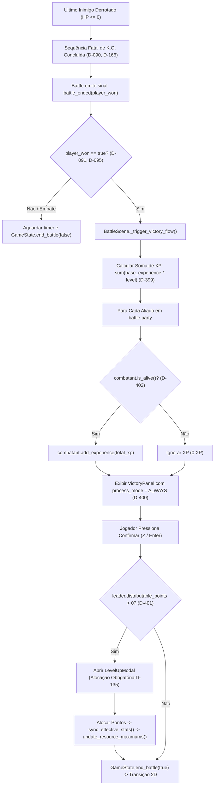

<!-- DEBUG-OBRIGATORIO-D1204 -->
> **DEBUG = OBRIGAÇÃO EXTREMA (D-1204).** O debug existe para testar QUALQUER milésimo do jogo: combate, Moves, VFX, overworld, UI, itens, IA, save, áudio.
> **NENHUM teste pode levar mais de 1 minuto** do pedido ao resultado; mire em menos de 10 s (`--scenario=<id> --stdout-trace --quit`).
> Sem caminho pronto no debug? **CRIE o cenário/controle** antes de testar. Nunca peça ao criador para clicar, ajustar slider ou montar nada.
> Teste SEMPRE no debug (`vfx_room`, `BattleDebug`), com dados (`--summary-json`, `--strict-asserts`), nas duas vistas (D-235); não improvise com o jogo real.
> Passou de 1 minuto = o debug está incompleto: melhore a ferramenta primeiro. Ver `docs/decisoes/D-1204-*.md` e `docs/TELEMETRIA.md`.
<!-- /DEBUG-OBRIGATORIO-D1204 -->

# Sistema de Experiência (XP), Vitória Pós-Combate e Level Up

*   **Author:** Criador & Assistente
*   **Status:** In Review (Stage 9 Resolved — Ready for Implementation)
*   **Date:** 2026-11-07

--------------------------------------------------------------------------------

## Overview

Este documento estabelece a especificação formal e a arquitetura técnica para o Sistema de Experiência (XP), apresentação da Tela de Vitória pós-combate e o fluxo do Modal de Subida de Nível (*Level Up*) no Crawlmon. O sistema consolida as decisões aprovadas em [D-399](../decisoes/D-399-curva-de-xp-e-recompensa-inimigos.md) a [D-402](../decisoes/D-402-xp-apenas-para-combatentes-sobreviventes.md), integrando a progressão matemática da curva de HP anti-hitkill ([D-392](../decisoes/D-392-escala-hp-anti-hitkill-e-marcos.md)), os atributos de 15 pontos base ([D-390](../decisoes/D-390-orcamento-15-pontos-base-nivel-1.md)), a regra de alocação imediata do líder ([D-135](../decisoes/D-135-r55-q5-seis-atributos-no-teto-sem-distribuicao.md), [D-394](../decisoes/D-394-progressao-pontos-nivel-jogador-e-aliados.md), [D-401](../decisoes/D-401-modal-obrigatorio-alocacao-pontos-lider.md)) e a independência total de lado e personagem ([D-235](../decisoes/D-235-moves-e-vfx-independentes-de-personagem-e-lado.md)).

--------------------------------------------------------------------------------

## Problem Statement

No protótipo atual, quando o último oponente tem seu HP reduzido a zero, a cena executa `GameState.end_battle(player_won)` de forma síncrona, retornando à exploração 2D ([`scenes/exploration.tscn`](file:///c:/Users/zerke/OneDrive/Área%20de%20Trabalho/Z/crawlmon/scenes/exploration.tscn)) sem transição de resultados ou cálculo de recompensa.
Com a conclusão do sistema biológico de 15 pontos, Natures e marcos de HP ([D-390](../decisoes/D-390-orcamento-15-pontos-base-nivel-1.md) a [D-394](../decisoes/D-394-progressao-pontos-nivel-jogador-e-aliados.md)), os combatentes possuem infraestrutura de atributos mas permanecem estáticos no nível 1:
1. Derrotar inimigos não gera experiência nem progressão de nível;
2. Não há tela de vitória para exibir o resultado do combate e o avanço da equipe;
3. O líder não dispõe de interface para alocar o 1 ponto concedido por nível (ou 3 nos marcos de nível 10, 20...), violando a exigência de alocação obrigatória na hora ([D-135](../decisoes/D-135-r55-q5-seis-atributos-no-teto-sem-distribuicao.md), [D-401](../decisoes/D-401-modal-obrigatorio-alocacao-pontos-lider.md));
4. Caso a concessão fosse aplicada indiscriminadamente, combatentes nocauteados receberiam experiência indevida.

A aprovação de [D-399](../decisoes/D-399-curva-de-xp-e-recompensa-inimigos.md) a [D-402](../decisoes/D-402-xp-apenas-para-combatentes-sobreviventes.md) fecha esse ciclo com:
* Curva de experiência por transição de nível: $\Delta\text{XP}(L) = 50 \times L^2$.
* Recompensa de experiência individual por oponente: $\text{XP\_Drop} = \text{base\_experience} \times \text{level}$ (com $\text{base\_experience} = 30$ para inimigos iniciais).
* Tela de vitória pós-combate com desaceleração suave, barras de progresso animadas e alerta visual de `LEVEL UP!`.
* Modal obrigatório de alocação de atributos do líder com bloqueio de saída até que todos os pontos livres (`distributable_points`) sejam distribuídos.
* Concessão de XP restrita a combatentes sobreviventes ($\text{HP} > 0$).

--------------------------------------------------------------------------------

## Goals

*   **G1 (Curva e Recompensas de Experiência):** Implementar as fórmulas matemáticas de XP por transição de nível ($\Delta\text{XP}(L) = 50 \times L^2$) e drop por inimigo ($\text{base\_experience} \times \text{level}$) em [`CrawlmonAttributeMath`](file:///c:/Users/zerke/OneDrive/Área%20de%20Trabalho/Z/crawlmon/scripts/combat/crawlmon_attribute_math.gd) ([D-399](../decisoes/D-399-curva-de-xp-e-recompensa-inimigos.md)).
*   **G2 (Crédito Integral a Sobreviventes):** Conceder o montante total de XP acumulado para cada membro ativo da equipe com $\text{HP} > 0$, bloqueando o avanço de combatentes em K.O. ([D-402](../decisoes/D-402-xp-apenas-para-combatentes-sobreviventes.md)).
*   **G3 (Tela de Vitória Pós-Combate):** Implementar `VictoryPanel` na camada de HUD de combate, desacelerando a cena 3D e aguardando confirmação do jogador (ação `confirm` / Z / Enter) ([D-400](../decisoes/D-400-tela-de-vitoria-e-pausa-pos-combate.md)).
*   **G4 (Modal de Alocação Imediata do Líder):** Se o líder da equipe possuir `distributable_points > 0`, abrir `LevelUpModal` imediatamente após a tela de vitória, forçando a distribuição de 1 ponto regular (ou 3 nos marcos) entre os 6 atributos antes de liberar o retorno ao 2D ([D-135](../decisoes/D-135-r55-q5-seis-atributos-no-teto-sem-distribuicao.md), [D-401](../decisoes/D-401-modal-obrigatorio-alocacao-pontos-lider.md)).
*   **G5 (Recálculo Automático de Recursos Máximos):** Ao subir de nível ou investir em VIT/WIS, invocar `sync_effective_stats()` e `update_resource_maximums()`, atualizando imediatamente $\text{max\_hp}$ e $\text{max\_mp}$ somando a variação $\Delta$ ao valor atual, preservando a integridade das barras ([D-391](../decisoes/D-391-renomeacao-spi-para-wis-e-scaling-mp.md), [D-392](../decisoes/D-392-escala-hp-anti-hitkill-e-marcos.md)).
*   **G6 (Independência e Desacoplamento):** Garantir que a lógica de concessão de XP e cálculo de nível funcione de forma autônoma em [`Combatant`](file:///c:/Users/zerke/OneDrive/Área%20de%20Trabalho/Z/crawlmon/scripts/combat/combatant.gd) e [`CrawlmonAttributeMath`](file:///c:/Users/zerke/OneDrive/Área%20de%20Trabalho/Z/crawlmon/scripts/combat/crawlmon_attribute_math.gd) sem requerer nós de interface para testes headless puros ([D-019](../decisoes/D-019-linha-do-tempo-unica.md), [D-235](../decisoes/D-235-moves-e-vfx-independentes-de-personagem-e-lado.md)).

--------------------------------------------------------------------------------

## Non-Goals

*   **NG1:** Não alterar a linha do tempo única do ATB, a fila de ações ou os custos de habilidades durante o combate ativo ([D-019](../decisoes/D-019-linha-do-tempo-unica.md)).
*   **NG2:** Não permitir microgerenciamento manual de atributos para os aliados da IA (a evolução dos companheiros segue a proficiência orgânica por ações em combate, [D-394](../decisoes/D-394-progressao-pontos-nivel-jogador-e-aliados.md)).
*   **NG3:** Não permitir acumular pontos de nível do líder para distribuição posterior (a alocação é obrigatória imediatamente após a batalha, [D-135](../decisoes/D-135-r55-q5-seis-atributos-no-teto-sem-distribuicao.md), [D-401](../decisoes/D-401-modal-obrigatorio-alocacao-pontos-lider.md)).
*   **NG4:** Não dividir o total de XP entre o número de participantes da equipe (o XP total concedido é entregue integralmente a cada sobrevivente, [D-399](../decisoes/D-399-curva-de-xp-e-recompensa-inimigos.md)).
*   **NG5:** Não introduzir caixas especulativas de espólio ou itens de loot nesta iteração (foco exclusivo em XP, barras de progresso e level up).

--------------------------------------------------------------------------------

## Open Questions

*   **Taxas Numéricas Exatas de Proficiência dos Aliados:** Conforme registrado em [D-394](../decisoes/D-394-progressao-pontos-nivel-jogador-e-aliados.md), os aliados acumulam seus contadores de combate em `action_counts` (`{"physical": 0, "magic": 0, "evade": 0, "guard": 0}`). A conversão matemática exata desses contadores em atributos permanentes permanece em aberto para calibração em design dedicado. Na presente entrega, aliados sobem de nível e recalculam seus tetos de HP/MP mantendo a integridade dos atributos inatos.
*   **Tabela de Recompensa de Base de XP para Futuras Espécies:** Fixou-se $\text{base\_experience} = 30$ para inimigos comuns iniciais (Gible). Futuros inimigos e chefes terão seus valores cadastrados individualmente.

--------------------------------------------------------------------------------

## Critical User Journeys (CUJs)

### CUJ 1: Vitória Pós-Combate sem Level Up
*   **Given**: O grupo do jogador (Abra e Pancham) derrota um Gible nível 1.
*   **When**: O último golpe conecta e o HP do Gible atinge 0.
*   **Then**:
    1. A sequência visual de K.O. do inimigo executa até o encolhimento e faíscas ([D-166](../decisoes/D-166-ko-encolhe-e-some-no-ar.md));
    2. O motor recebe `battle_ended(true)` em [`BattleScene._on_battle_ended`](file:///c:/Users/zerke/OneDrive/Área%20de%20Trabalho/Z/crawlmon/scripts/combat/battle_scene.gd);
    3. O combate desacelera suavemente (tween de `time_scale` para 0.2) e abre o `VictoryPanel`;
    4. O painel exibe: $+30$ XP obtido;
    5. As barras de XP de Abra e Pancham animam preenchendo de 0 a 30 de um total de 50 XP (Nível 1);
    6. O jogador pressiona a tecla Confirmar (Z / Enter / Botão A);
    7. O combate é finalizado e `GameState.end_battle(true)` retorna para o mapa 2D.

### CUJ 2: Vitória Pós-Combate com Level Up do Protagonista Líder
*   **Given**: Abra (Líder, nível 1) possui 40 XP acumulados e derrota um inimigo que concede 30 XP (total acumulado = 70 XP).
*   **When**: O combate encerra com vitória (`player_won == true`).
*   **Then**:
    1. `VictoryPanel` abre e a barra de XP anima de 40 até 50, emite alerta visual de `LEVEL UP!` destacando que Abra atingiu o Nível 2, e a barra reseta preenchendo os 20 XP excedentes rumo ao Nível 3 (requisito = 200 XP);
    2. O jogador pressiona Confirmar no `VictoryPanel`;
    3. Conforme [D-401](../decisoes/D-401-modal-obrigatorio-alocacao-pontos-lider.md), como `leader.distributable_points > 0`, abre-se imediatamente o `LevelUpModal`;
    4. O modal exibe "Pontos Disponíveis: 1" e controles de navegação para os 6 atributos (**STR, MAG, VIT, WIS, AGI, LUK**);
    5. O botão "Confirmar" permanece desabilitado enquanto houver 1 ponto restante;
    6. O jogador incrementa MAG em +1;
    7. O botão "Confirmar" é habilitado e o jogador confirma;
    8. `leader.progression_points["MAG"] += 1`, `leader.distributable_points -= 1`, `leader.sync_effective_stats()` e `leader.update_resource_maximums()` consolidam a alteração;
    9. `GameState.end_battle(true)` é invocado e o jogo transiciona para a exploração 2D.

### CUJ 3: Sobrevivente vs Combatente Nocauteado (K.O.)
*   **Given**: Pancham é nocauteado ($\text{HP} = 0$), mas Abra sobrevive ($\text{HP} = 15$) e finaliza o inimigo.
*   **When**: A vitória é processada.
*   **Then**:
    1. Abra recebe integralmente os 30 XP da batalha;
    2. Pancham recebe 0 XP e sua barra de experiência permanece inalterada ([D-402](../decisoes/D-402-xp-apenas-para-combatentes-sobreviventes.md));
    3. `VictoryPanel` exibe o cartão de Pancham com etiqueta "K.O." e "+0 XP";
    4. Os contadores de ações de Pancham executadas antes do nocaute são preservados na ficha.

--------------------------------------------------------------------------------

## Detailed Design



### 1. Fórmulas Matemáticas em `CrawlmonAttributeMath`

As regras de progressão e experiência são implementadas como métodos estáticos em [`CrawlmonAttributeMath`](file:///c:/Users/zerke/OneDrive/Área%20de%20Trabalho/Z/crawlmon/scripts/combat/crawlmon_attribute_math.gd):

1. **Requisito de Experiência por Nível (Delta de Transição):**
   $$\Delta\text{XP}(L) = 50 \times L^2$$
   * Nível 1 $\to$ 2: $50 \times 1^2 = 50$ XP necessários.
   * Nível 2 $\to$ 3: $50 \times 2^2 = 200$ XP necessários.
   * Nível 3 $\to$ 4: $50 \times 3^2 = 450$ XP necessários.
   * Nível 9 $\to$ 10 (Marco): $50 \times 9^2 = 4.050$ XP necessários.
   *(Nota: O total histórico cumulativo para atingir o nível $L$ é a soma dos quadrados: $\sum_{k=1}^{L-1} 50 k^2 = \frac{50 (L-1) L (2L-1)}{6}$)*.

2. **Recompensa por Inimigo Derrotado:**
   $$\text{XP\_Drop} = \text{base\_experience} \times \text{level}$$
   * Padrão inicial: $\text{base\_experience} = 30$.

3. **Pontos de Atributo Concedidos por Nível:**
   $$\text{Pontos\_Ganhos}(L) = \begin{cases} 3, & \text{se } L \pmod{10} = 0 \\ 1, & \text{caso contrário} \end{cases}$$

```gdscript
## Retorna a quantidade de XP necessaria para transicionar do nivel atual para o proximo (D-399).
static func get_xp_for_level_transition(current_level: int) -> int:
	var lvl := maxi(1, current_level)
	return 50 * lvl * lvl

## Retorna a experiencia dropada pela derrota de um oponente (D-399).
static func get_enemy_xp_drop(base_exp: int, level: int) -> int:
	return maxi(1, base_exp) * maxi(1, level)

## Retorna os pontos de atributo distribuidos ao alcancar determinado nivel (D-394).
static func get_stat_points_for_level(new_level: int) -> int:
	return 3 if new_level % 10 == 0 else 1
```

### 2. Modificações em `Combatant` (`scripts/combat/combatant.gd`)

Reúso rigoroso das variáveis existentes `xp: int = 0` e `distributable_points: int = 0`. Adição da propriedade `base_experience: int = 30` e implementação desacoplada de `add_experience(amount: int) -> Dictionary`:

```gdscript
var base_experience: int = 30

signal experience_gained(amount: int, current_xp: int, xp_required: int)
signal level_up_occurred(new_level: int, points_gained: int)

func add_experience(amount: int) -> Dictionary:
	var old_level: int = level
	var old_xp: int = xp
	var current_req: int = CrawlmonAttributeMath.get_xp_for_level_transition(level)

	if amount <= 0:
		return {
			"old_level": old_level,
			"new_level": level,
			"levels_gained": 0,
			"points_gained": 0,
			"old_xp": old_xp,
			"current_xp": xp,
			"xp_required": current_req,
			"transitions": []
		}

	xp += amount
	var levels_gained: int = 0
	var total_points: int = 0
	var transitions: Array[Dictionary] = []

	while true:
		var req: int = CrawlmonAttributeMath.get_xp_for_level_transition(level)
		if xp >= req:
			xp -= req
			level += 1
			levels_gained += 1
			var pts: int = CrawlmonAttributeMath.get_stat_points_for_level(level)
			total_points += pts
			if is_player and is_party_leader():
				distributable_points += pts
			update_resource_maximums()
			transitions.append({"level": level, "points": pts, "xp_required": req})
			level_up_occurred.emit(level, pts)
		else:
			break

	experience_gained.emit(amount, xp, CrawlmonAttributeMath.get_xp_for_level_transition(level))
	return {
		"old_level": old_level,
		"new_level": level,
		"levels_gained": levels_gained,
		"points_gained": total_points,
		"old_xp": old_xp,
		"current_xp": xp,
		"xp_required": CrawlmonAttributeMath.get_xp_for_level_transition(level),
		"transitions": transitions
	}
```

### 3. Modificações no Fluxo de Batalha (`BattleScene`)

No manipulador real `_on_battle_ended(player_won: bool)` em [`scripts/combat/battle_scene.gd`](file:///c:/Users/zerke/OneDrive/Área%20de%20Trabalho/Z/crawlmon/scripts/combat/battle_scene.gd):

```gdscript
func _on_battle_ended(player_won: bool) -> void:
	_end_decision_slowmo()
	_end_slowmo()
	fx.finish(player_won)
	_menu.hide()
	hud.set_target(null)

	if player_won:
		_trigger_victory_flow()
	else:
		await get_tree().create_timer(3.0, true, false, true).timeout
		GameState.end_battle(false)

func _trigger_victory_flow() -> void:
	# 1. Desacelera suavemente o combate
	var tween := create_tween()
	tween.tween_property(Engine, "time_scale", 0.2, 0.6)

	# 2. Computa soma de XP dos inimigos abatidos
	var total_xp: int = 0
	for enemy in battle.enemies:
		if enemy != null:
			total_xp += CrawlmonAttributeMath.get_enemy_xp_drop(enemy.base_experience, enemy.level)

	# 3. Concede XP apenas para membros sobreviventes (D-402)
	var party_summaries: Array[Dictionary] = []
	for member in battle.party:
		if member == null:
			continue
		if member.is_alive():
			var res: Dictionary = member.add_experience(total_xp)
			res["combatant"] = member
			res["is_alive"] = true
			party_summaries.append(res)
		else:
			party_summaries.append({
				"combatant": member,
				"is_alive": false,
				"old_level": member.level,
				"new_level": member.level,
				"levels_gained": 0,
				"points_gained": 0,
				"old_xp": member.xp,
				"current_xp": member.xp,
				"xp_required": CrawlmonAttributeMath.get_xp_for_level_transition(member.level),
				"transitions": []
			})

	# 4. Abre o VictoryPanel
	var panel := VictoryPanelScript.new()
	panel.process_mode = Node.PROCESS_MODE_ALWAYS
	ui.add_child(panel)
	panel.open(total_xp, party_summaries)
	await panel.victory_confirmed

	# 5. Restaura escala de tempo
	Engine.time_scale = 1.0

	# 6. Verifica alocacao compulsoria do lider (D-135, D-401)
	var leader: Combatant = battle.party[0] if not battle.party.is_empty() else null
	if leader != null and leader.distributable_points > 0:
		var modal := LevelUpModalScript.new()
		modal.process_mode = Node.PROCESS_MODE_ALWAYS
		ui.add_child(modal)
		modal.open(leader)
		await modal.modal_closed

	# 7. Retorna para a exploracao 2D
	GameState.end_battle(true)
```

### 4. Interface de Usuário: `VictoryPanel` e `LevelUpModal`

*   **`VictoryPanel` (`scripts/ui/victory_panel.gd`):**
    - Painel centralizado ancorado em `CanvasLayer` com `process_mode = Node.PROCESS_MODE_ALWAYS`.
    - Exibe total de XP ganho e cartões para cada combatente com:
      - Nome, Nível e barra de progresso visual de XP animada via `Tween`;
      - Etiqueta piscante `LEVEL UP!` para combatentes que subiram de nível;
      - Etiqueta cinza `K.O. (+0 XP)` para combatentes derrotados.
    - Captura de input: avança com ação `confirm` (Z / Enter / Botão A).
*   **`LevelUpModal` (`scripts/ui/level_up_modal.gd`):**
    - Janela modal bloqueante com `process_mode = Node.PROCESS_MODE_ALWAYS`.
    - Cabeçalho: "LEVEL UP - ALOCAÇÃO DE ATRIBUTOS".
    - Indicador de saldo: "Pontos Disponíveis: X".
    - 6 linhas de atributos (**STR, MAG, VIT, WIS, AGI, LUK**):
      - Navegação vertical (`ui_up`, `ui_down`) para selecionar o atributo;
      - Ajuste horizontal (`ui_right` / `ui_left`) ou cliques em `[ + ]` / `[ - ]` para alocar pontos;
      - Botão "CONFIRMAR": habilitado exclusivamente quando o saldo de pontos a distribuir chegar a 0 ([D-401](../decisoes/D-401-modal-obrigatorio-alocacao-pontos-lider.md)).
    - Ao confirmar:
      ```gdscript
      for stat in session_allocated:
          leader.progression_points[stat] += session_allocated[stat]
      leader.distributable_points -= total_allocated
      leader.sync_effective_stats()
      leader.update_resource_maximums()
      emit_signal("modal_closed")
      queue_free()
      ```

--------------------------------------------------------------------------------

## Security, Reliability & Edge Cases

1. **Empate e Derrota Simultânea (D-091, D-095):** Se todos os combatentes de ambas as equipes forem nocauteados no mesmo instante lógico, `battle_ended(player_won)` emite `false`. A cena executa o ramo de derrota sem invocar o `VictoryPanel` e sem conceder XP.
2. **Ganho de Múltiplos Níveis em Luta Única:** O laço `while xp >= req` em `Combatant.add_experience` consome sucessivamente os deltas e acumula os pontos distribuíveis (ex.: ganhar 300 XP no Nível 1 eleva para o Nível 3, concedendo 2 pontos livres). O `LevelUpModal` recebe o saldo consolidado total e só fecha quando todos os pontos forem alocados.
3. **Consistência Atômica de Recursos Máximos:** Atualizações de nível somam $+10$ HP por nível regular ($+35$ HP em marcos de 10) e $+1$ MP por nível regular. O HP/MP atual é incrementado pelo mesmo delta $\Delta$, impedindo cura total involuntária ou ressurreição indevida.
4. **Isolamento de Input e Foco:** O `LevelUpModal` e `VictoryPanel` consomem eventos de entrada marcando `get_viewport().set_input_as_handled()`, impedindo que cliques ou teclas vazem para o HUD de combate subjacente.

--------------------------------------------------------------------------------

## Test Plan

Os testes automatizados serão criados em [`tests/combat/test_experience_and_victory.gd`](file:///c:/Users/zerke/OneDrive/Área%20de%20Trabalho/Z/crawlmon/tests/combat/test_experience_and_victory.gd) e executados via terminal headless:

1. **`test_experience_math_transitions()`:**
   - Valida que `CrawlmonAttributeMath.get_xp_for_level_transition(1)` retorna exatamente 50.
   - Valida que `get_xp_for_level_transition(2)` retorna exatamente 200.
   - Valida que `get_xp_for_level_transition(9)` retorna exatamente 4.050.
2. **`test_enemy_xp_drop()`:**
   - Inimigo nível 1 com base 30 dropa exatamente 30 XP.
   - Inimigo nível 3 com base 30 dropa exatamente 90 XP.
3. **`test_combatant_single_level_up()`:**
   - Líder nível 1 recebe 50 XP: atinge Nível 2 com 0 XP residual e 1 `distributable_points`.
   - Verifica recalculo: $\Delta\text{max\_hp} = +10$ e $\Delta\text{max\_mp} = +1$.
4. **`test_combatant_multi_level_up()`:**
   - Líder nível 1 recebe 300 XP: consome 50 (Nível 2), consome 200 (Nível 3), resta com 50 XP e 2 `distributable_points`.
5. **`test_milestone_level_up_points_and_hp()`:**
   - Combatente no nível 9 sobe para nível 10: ganha 3 pontos de atributo ([D-394](../decisoes/D-394-progressao-pontos-nivel-jogador-e-aliados.md)) e seu $\text{max\_hp}$ aumenta em exatamente $+35$ HP ($+10$ do nível $+ 25$ do marco, [D-392](../decisoes/D-392-escala-hp-anti-hitkill-e-marcos.md)).
6. **`test_ko_combatant_receives_no_xp()`:**
   - Combatente com $\text{hp} = 0$ recebe chamada de experiência na vitória: não ganha XP, não sobe de nível e mantém `xp = 0` ([D-402](../decisoes/D-402-xp-apenas-para-combatentes-sobreviventes.md)).
7. **`test_leader_stat_allocation_and_sync()`:**
   - Alocar ponto em VIT: incrementa `progression_points["VIT"]`, reduz `distributable_points`, invoca `sync_effective_stats()` e eleva $\text{max\_hp}$ em $+2$ HP ([D-392](../decisoes/D-392-escala-hp-anti-hitkill-e-marcos.md)).
