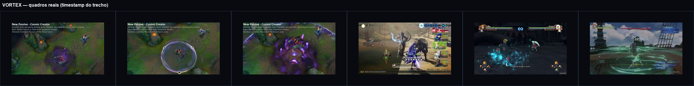
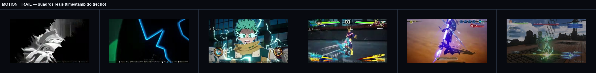
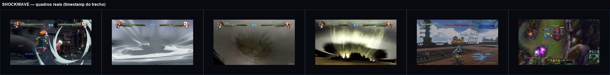
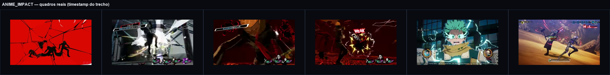

# Pesquisa de VFX — 4 efeitos para a cena Godot separada

- **Data:** 2026-11-08
- **Decisão:** D-1017 (Godot, cena separada, sem HTML; Slash Arc descartado; por ora só pesquisa).
- **Escopo:** 4 dos 19 componentes, escolhidos pelo assistente; **nenhum código foi escrito**.
- **Método:** vídeos públicos dos jogos citados pelo criador, trechos baixados, quadros extraídos e conferidos em tamanho real. Os tempos abaixo são **relativos ao trecho baixado**; a coluna “vídeo original” dá o tempo absoluto quando o trecho não começa em 0:00.

## 1. Os quatro escolhidos

| # | Componente | Família | O que a pesquisa precisa provar |
|---|---|---|---|
| 1 | **LIB-VFX-01 — Vortex Mesh** | Formas | vórtice com volume, núcleo escuro, anel/borda legível e leitura de cima |
| 2 | **LIB-VFX-08 — Motion Trail** | Movimento | rastro grosso, com cor e branco, que não suma de perfil |
| 3 | **LIB-VFX-13 — Shockwave Ring** | Impacto | anel no chão + dome/onda no ar + poeira, com tempo de expansão claro |
| 4 | **LIB-VFX-17 — Anime Impact Flipbook** | Impacto | impacto em flipbook/cut-in, com silhueta, texto e mudança de fundo |

A escolha cobre **forma, movimento, impacto e flipbook** — as quatro capacidades que a cena-laboratório precisa validar antes de portar o resto.

## 2. O que os quatro jogos ensinam (leitura transversal)

| Jogo | Papel na pesquisa | Lição principal |
|---|---|---|
| **Persona 5 Royal** | impacto anime / flipbook | o impacto não é só uma explosão: muda o fundo, vira silhueta, entra texto e held frame; alto contraste vermelho/preto/branco |
| **Shin Megami Tensei V** | aura, charge e “CRITICAL” | carga lenta com núcleo branco; o crítico é um flash curto + texto; a UI faz parte do efeito |
| **Naruto Ultimate Ninja Storm** | shockwave / dome | anel branco fino + dome de poeira; o impacto tem um “antes” (carga) e um “depois” (poeira que assenta) |
| **Granblue Fantasy: Relink** | anéis no chão, feixes, cor | anéis concêntricos no chão, feixe vertical e cor teal/azul; o efeito é legível de longe e não depende de detalhe fino |
| **League of Legends** | vórtice / leitura de cima | núcleo escuro + borda brilhante; a silhueta do anel é o que lê, não o miolo |
| **Boku no Hero: All's Justice** | speed lines / rastro | linhas grossas de velocidade, preto/branco ou cor; close-up e cut-in vendem o impacto |

**Conclusão transversal:** nenhum dos quatro efeitos é “uma camada só”. Todos têm **3–5 camadas** com funções diferentes (flash, corpo, borda, detritos, poeira, texto/fundo). O que muda entre eles é a **ordem** e o **tempo**.

## 3. Vortex Mesh

### Quadros reais

| Frame | Jogo / tempo | O que mostra |
|---|---|---|
| `VORTEX_lol_asol_2.0.png` | LoL, Aurelion Sol, 2,0 s | vórtice pequeno: miolo escuro, borda violeta, chão ainda visível |
| `VORTEX_lol_asol_5.0.png` | LoL, Aurelion Sol, 5,0 s | black hole grande: anel branco-violeta fino, interior quase preto, borda externa suave |
| `VORTEX_lol_asol_7.0.png` | LoL, Aurelion Sol, 7,0 s | explosão violeta/roxa com estrelas; o núcleo escuro desaparece no clarão |
| `VORTEX_smtv_zeus_0.5.png` | SMT V, Demeter/Zeus, 0,5 s do trecho (2:14,5 do vídeo) | aura azul no corpo, chifre luminoso; carga, não vórtice |
| `VORTEX_naruto_pain_0.5.png` | Naruto Storm 4, Pain, 0,5 s (19:37,5) | vórtice azul no chão, com línguas para cima e poeira |
| `VORTEX_gbf_skybound_6.0.png` | Granblue, 6,0 s | anel verde/teal no chão com vento circular; leitura de cima |

### Leitura

- **LoL é a melhor referência de silhueta:** o vórtice vive entre um **núcleo escuro** e uma **borda fina e brilhante**. O miolo não precisa de detalhe; o anel é o que lê a 20–30 m.
- **Naruto mostra o volume:** o vórtice no chão tem **línguas/colunas** que sobem, não é um disco plano. A poeira na base dá a escala.
- **Granblue mostra o anel no chão:** concêntrico, com vento; a cor teal/verde é chapada e o contraste com o chão é alto.
- **SMT V é carga, não vórtice:** a aura azul no corpo serve para a **entrada** do efeito (wind-up), não para o redemoinho em si.

### Tradução para Godot

- **Malha:** funil/cone (`mc_vortex_drill.gdshader` já existe) para o volume; disco com espiral (`mc_vortex_disc.gdshader`) para o release; anel no chão (`ring.gdshader`/`mc_shock_ring.gdshader` adaptado) para a base.
- **Camadas:** (1) núcleo escuro quase opaco; (2) cone com braços espirais em blend add; (3) anel externo fino; (4) partículas/estrelas orbitando (`CPUParticles3D`); (5) poeira no chão.
- **Movimento:** giro contínuo no shader (`tt`), subida das partículas, expansão do anel; `AnimationPlayer` controla a vida e o fade.
- **Cuidado:** hélice/espiral vista de frente vira anel (lição do protocolo). Para não sumir de perfil, o cone precisa de volume e o anel precisa de espessura.
- **Não usar:** GPUParticles, decals, sub-emitters (GL Compatibility).

## 4. Motion Trail

### Quadros reais

| Frame | Jogo / tempo | O que mostra |
|---|---|---|
| `MOTION_TRAIL_mha_deku_1.0.png` | MHA, Deku, 1,0 s | silhueta branca em fundo preto com linhas de velocidade; o corpo virou leitura gráfica |
| `MOTION_TRAIL_mha_deku_2.0.png` | MHA, 2,0 s | raio azul grosso em fundo preto; linha única, bem legível |
| `MOTION_TRAIL_mha_deku_5.5.png` | MHA, 5,5 s | close-up com raios verdes/brancos; o rastro é o próprio corpo |
| `MOTION_TRAIL_mha_deku_9.0.png` | MHA, 9,0 s | dash com speed lines; uma faixa branca/verde segue o corpo |
| `MOTION_TRAIL_smtv_nahobino_5.0.png` | SMT V, 5,0 s | fenda azul/roxa de espada; rastro grosso, poucas linhas |
| `MOTION_TRAIL_gbf_skybound_5.0.png` | Granblue, 5,0 s | corte verde/teal com rastro curvo e brilho no chão |

### Leitura

- **MHA usa poucas linhas grossas**, não muitas finas. O rastro é uma **silhueta** que acompanha o corpo; o fundo preto/branco é tão importante quanto o efeito.
- **SMT V** mostra um rastro de arma **curto, grosso e com núcleo branco**; a cor vem da borda, não do miolo.
- **Granblue** mostra o rastro preso ao movimento do corpo/arma, com **curva** e partículas no chão; o rastro não é uma linha reta.
- **Erro comum:** fita fina que desaparece de perfil. O rastro precisa de **volume** (2–3 quads cruzados ou um tubo achatado) e de uma largura mínima.

### Tradução para Godot

- **`TrailRenderer` GDScript** (`addons/TrailRenderer/Runtime/GD/trail_renderer.gd`, `class_name TrailRenderer`): `lifetime`, `min_vertex_distance`, `is_emitting`, `Gradient` e `Curve` para largura/cor. É o caminho mais direto para o rastro preso à mão/arma.
- **Camadas:** (1) under-trail escuro/roxo; (2) corpo colorido; (3) núcleo branco fino; (4) speed lines em quads (`streak.gdshader`); (5) faíscas (`CPUParticles3D`).
- **Timing:** o rastro nasce no wind-up, engorda no release, viaja com o corpo e **dissipa depois** do impacto; não pode ficar parado no ar.
- **Cuidado:** o rastro de MHA é **screen-space** em parte; no Godot, separar o que é 3D (trail preso ao corpo) do que é 2D (speed lines de tela, se necessário).
- **Não usar:** fita única sem espessura; rastro que não segue a mão.

## 5. Shockwave Ring

### Quadros reais

| Frame | Jogo / tempo | O que mostra |
|---|---|---|
| `SHOCKWAVE_naruto_pain_2.5.png` | Naruto, Pain, 2,5 s (19:39,5) | anel branco fino em volta do corpo; o centro ainda está escuro |
| `SHOCKWAVE_naruto_pain_6.5.png` | Naruto, Pain, 6,5 s (19:43,5) | dome/onda branca enorme, com poeira e chão desaparecendo |
| `SHOCKWAVE_naruto_madara_4.0.png` | Naruto, Madara, 4,0 s (17:04) | dome de poeira/cinza, borda iluminada, silhueta do corpo no centro |
| `SHOCKWAVE_naruto_madara_6.0.png` | Naruto, Madara, 6,0 s (17:06) | onda branca/amarela subindo, com raios e poeira na base |
| `SHOCKWAVE_gbf_skybound_13.0.png` | Granblue, 13,0 s | anel azul no chão, concêntrico, com partículas e dano |
| `SHOCKWAVE_lol_sett_6.0.png` | LoL, Sett, 6,0 s | anel roxo no chão, centro escuro, borda magenta; leitura de cima |

### Leitura

- **Naruto é a referência de escala:** o anel branco fino (2,5 s) e o dome (6,5 s) são **o mesmo efeito em duas escalas**. O dome tem poeira na base e uma borda iluminada; o centro não é branco chapado, é uma parede de poeira.
- **Granblue** mostra o anel no chão com **vários anéis concêntricos** e um feixe/impacto vertical; a cor é chapada e o contraste é alto.
- **LoL** mostra o anel de cima: **centro escuro + borda magenta**; a silhueta é um círculo, não um disco cheio.
- **P5R** (ver Anime Impact) mostra o flash branco antes do anel; o anel não nasce sozinho, ele é o **segundo** estágio do impacto.

### Tradução para Godot

- **Anel no chão:** malha de anel (annulus/torus achatado) com UV radial; 2–3 anéis com velocidades e larguras diferentes; `AnimationPlayer` escala e apaga.
- **Dome/onda no ar:** hemisfério ou cone achatado com shader de ruído/dissolve; a borda é mais brilhante que o miolo; poeira na base (`CPUParticles3D`).
- **Flash:** `flipbook_impact.png` ou `mc_sprite.gdshader` (alpha mix) / `flipbook.gdshader` (add) por 0,08–0,15 s.
- **Câmera:** o protocolo pede leitura normal e espelhada; o anel não pode depender de ângulo. O dome precisa de geometria, não de um quad billboard.
- **Cuidado:** `mc_shock_ring.gdshader` é um quad virado para a câmera; para o anel no chão, usar malha e UV radial, senão ele “deita” errado quando a câmera muda. Nada de decals (GL Compatibility).

## 6. Anime Impact Flipbook

### Quadros reais

| Frame | Jogo / tempo | O que mostra |
|---|---|---|
| `ANIME_IMPACT_p5r_allout_5.5.png` | P5R, all-out, 5,5 s | fundo vermelho chapado, silhueta preta, respingo branco; o mundo sumiu |
| `ANIME_IMPACT_p5r_critical_1.0.png` | P5R, crítico, 1,0 s | flash branco com detritos pretos/vermelhos; o impacto é quase abstrato |
| `ANIME_IMPACT_p5r_critical_8.5.png` | P5R, 8,5 s | dourado/preto, silhueta e linhas de impacto; alto contraste |
| `ANIME_IMPACT_p5r_critical_9.5.png` | P5R, 9,5 s | “WEAK” com manchas pretas e contorno branco; texto dentro do efeito |
| `ANIME_IMPACT_mha_deku_5.5.png` | MHA, 5,5 s | close-up com raios verdes/brancos; o rosto é o fundo do impacto |
| `ANIME_IMPACT_smtv_nahobino_33.0.png` | SMT V, 33,0 s | “CRITICAL” no meio de um clarão azul/roxo; UI e efeito juntos |

### Leitura

- **P5R é a referência principal:** o impacto troca o **fundo** (vermelho/preto), a **silhueta** e o **texto**. Não é só uma explosão no ponto de contato; é uma **edição** de quadros.
- **A ordem importa:** flash → silhueta/held frame → texto/cut-in → volta ao jogo. O hold é curto (0,1–0,3 s), mas é o que vende o golpe.
- **SMT V** é mais contido: flash + “CRITICAL” + aura; serve para um impacto que não para o jogo inteiro.
- **MHA** usa o close-up do rosto e as linhas de energia como parte do impacto; o efeito é **2D sobre 3D**, não só 3D.
- **Cores:** P5R vermelho/preto/branco; SMT V azul/roxo/branco; MHA verde/branco/preto. A paleta é limitada e chapada.

### Tradução para Godot

- **Flipbook 3D:** `flipbook.gdshader` (aditivo, para flash) ou `mc_sprite.gdshader` (alpha mix, para cores chapadas); `assets/vfx/flipbook_impact.png` 4×4; `Sprite3D`/quad billboard.
- **Camada 2D:** `CanvasLayer` para texto, speed lines e fundo chapado; isso é o que P5R faz e o que um flipbook sozinho não entrega.
- **Timing:** `AnimationPlayer` com hold frame; hitstop e shake de câmera no laboratório (não no jogo principal).
- **Cuidado:** flipbook aditivo “lava” cores chapadas em fundo claro; para o P5R-like, usar alpha mix (`mc_sprite.gdshader`). O flash pode ser aditivo; o corpo do impacto, não.
- **Não usar:** GPUParticles/decals; o impacto precisa de quadros desenhados, não de partículas genéricas.

## 6.1 Tempos observados (aproximados, não são regra)

| Efeito | Entrada / carga | Pico | Cauda |
|---|---|---|---|
| **Vortex** | 0,5–2,0 s (LoL cresce; SMT V carrega) | 0,2–0,4 s (colapso/explosão) | 1–2 s (brasas/poeira) |
| **Motion Trail** | 0,2–0,5 s (nasce no wind-up) | 0,3–0,6 s (dash) | 0,5–1,0 s (dissipa) |
| **Shockwave** | 0,1–0,3 s (flash) | 0,2–0,5 s (anel) / 0,5–1,0 s (dome) | 1–2 s (poeira assentando) |
| **Anime Impact** | 0,1 s (flash) | 0,1–0,3 s (held frame/texto) | 0,5–1,0 s (volta ao jogo) |

Os números são **faixas lidas dos trechos a 1–2 fps**, não medições quadro a quadro. A cena Godot deve medir os tempos reais antes de fixar qualquer duração.

## 7. Mapa técnico do projeto

| Peça | Onde está | Uso nesta pesquisa |
|---|---|---|
| `mc_vortex_drill.gdshader` | `shaders/` | cone/funil com braços espirais para o Vortex |
| `mc_vortex_disc.gdshader` | `shaders/` | disco espiral para o release/explosão do Vortex |
| `mc_shock_ring.gdshader` | `shaders/` | anel billboard; adaptar para anel no chão com malha |
| `ring.gdshader` | `shaders/` | anel simples para a base |
| `flipbook.gdshader` | `shaders/` | flipbook aditivo (flash) |
| `mc_sprite.gdshader` | `shaders/` | flipbook alpha mix (cores chapadas) |
| `streak.gdshader` | `shaders/` | speed lines / rastro fino |
| `TrailRenderer` | `addons/TrailRenderer/Runtime/GD/` | rastro 3D preso à mão/arma |
| `flipbook_impact.png` | `assets/vfx/` | atlas 4×4 de impacto |
| `flipbook_smoke.png` | `assets/vfx/` | poeira/fumaça |
| `shock_cone.glb` | `assets/vfx/` | cone de choque para o dome |
| `vfx_animation_player` | `addons/` | preview de partículas no editor (habilitar) |
| `brackeys_particle_controls` | `addons/` | preview de partículas no editor (habilitar) |

## 8. O que a pesquisa ainda não cobre

- **Resolução:** os trechos baixados são 480p/360p; antes de modelar, vale capturar 1–2 quadros em 1080p/4K dos mesmos momentos.
- **Vortex:** falta um exemplo de vórtice 3D com **volume** claro em Granblue/Naruto; o LoL é top-down e o Naruto é um vórtice no chão. Procurar um boss/porta de Granblue ou um jutsu de Naruto com redemoinho vertical.
- **Shockwave:** falta um frame de **dome** no jogo com a câmera do jogo (Naruto é cinematic); o dome de Madara é o mais próximo.
- **Anime impact:** falta um exemplo de P5R **sem** cut-in de personagem, só o impacto no inimigo, para separar o que é efeito do que é UI.
- **Motion trail:** falta um exemplo de rastro **de arma** em Granblue/Naruto com a câmera de gameplay, não cinematic.
- **Técnica:** não abri breakdowns de artistas (VFX Apprentice/RealTimeVFX) nesta rodada; a próxima passada pode trazer 2–3 breakdowns de shockwave/vortex/trail.
- **Outros jogos candidatos:** Guilty Gear Strive (impacto anime), Genshin Impact (vortex/shockwave), Final Fantasy XVI (shockwave), Dragon Ball FighterZ (speed lines). Não foram capturados nesta rodada; entram se o criador quiser ampliar.

## 9. Links dos vídeos

| Jogo | Vídeo | Trecho usado |
|---|---|---|
| P5R all-out | https://www.youtube.com/watch?v=PRNCg6ichcU | 0:00–0:12 (Joker) |
| P5R critical | https://www.youtube.com/watch?v=Ra5KiyIXcEI | 0:00–0:30 |
| SMT V Magatsuhi | https://www.youtube.com/watch?v=wv0HnTWULFI | 2:14–2:33 (Demeter/Zeus) |
| SMT V Nahobino | https://www.youtube.com/watch?v=ggi2tG9G4aw | 0:00–0:40 |
| MHA All's Justice | https://www.youtube.com/watch?v=ASkRfsxIdqU | 0:00–0:18 (Deku) |
| Naruto Storm 4 | https://www.youtube.com/watch?v=4Yrvvi26uPM | 19:37–19:46 (Pain); 17:00–17:25 (Madara) |
| Granblue Relink | https://www.youtube.com/watch?v=yv9H3RwSw78 | 0:00–0:30 |
| LoL Aurelion Sol | https://www.youtube.com/watch?v=zf8mU4kGC00 | 0:00–0:30 |
| LoL Sett | https://www.youtube.com/watch?v=UE0VRzZ28WA | 0:00–0:15 |

## 10. Próximo passo

Nenhum código foi escrito. A pesquisa está **aguardando aprovação** e uma decisão sobre o que aprofundar antes de abrir a cena Godot. A proposta é começar pelo **Anime Impact Flipbook** (é o que mais depende de flipbook e o que a cena pode validar primeiro), mas o criador pode trocar a ordem.
